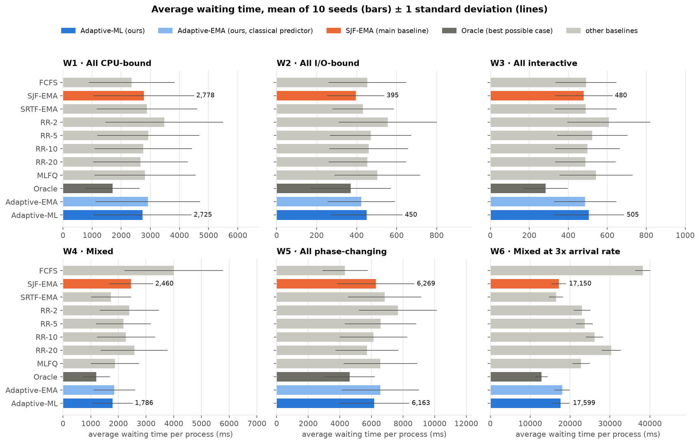

# Adaptive CPU Scheduling Using Predicted Burst Lengths

Operating Systems project · B.Tech CSE, Third Year

Shivaansh Aggarwal (24BCE0883) · Devansh Sharma (24BCE0717)

A CPU scheduler that **guesses how long each process will run next** (with a
small machine-learning model trained on the process's past behaviour) and uses
that guess twice:

1. **to choose which process runs next**: shortest predicted burst first, plus an
   ageing term so long processes cannot starve;
2. **to resize the time quantum while the system runs**: the textbook rule
   "about 80% of bursts should fit in one quantum", applied continuously from
   live predictions instead of once by hand.

It is tested in a discrete-event simulator against FCFS, SJF, SRTF, Round Robin
(four quanta), MLFQ and an oracle that knows the future, on six workload types
with ten random seeds each.

---

## Quick start

Requires Python 3.10 or newer.

```bash
cd ai_cpu_scheduler
python3 -m venv .venv
source .venv/bin/activate
pip install -r requirements.txt
```

Then run these in order (the times are for a 10-core laptop):

| Step | Command | Time | What it does |
|---|---|---|---|
| 1 | `pytest` | 1 s | 37 unit tests, including the textbook checks |
| 2 | `python train_models.py` | 10 s | trains and compares the predictors, saves `models/` |
| 3 | `python demo.py` | 10 s | **live demo for the presentation** |
| 4 | `python tune_beta.py` | 1 min | chooses the ageing weight β on separate seeds |
| 5 | `python run_experiments.py` | 5 min | the full experiment (1,060 simulation runs) |
| 6 | `python analyse.py` | 10 s | writes `results/REPORT.md` and `figures/*.png` |

`python run_experiments.py --quick` (3 seeds, no sweeps) finishes in under a minute.
`python demo.py --workload W5` runs the demo on another workload, and `python demo.py --part 1` (or `2`, `3`) runs a single part.

## What to show in the presentation

1. `python demo.py`. Part 1 shows the simulator reproducing the textbook
   answers (FCFS 17 ms, SJF 3 ms, RR 5.67 ms, SRTF 6.5 ms) with Gantt charts.
   Part 2 shows exponential averaging lagging behind a process that changes
   phase. Part 3 runs all 11 schedulers on the same workload.
2. `figures/fig4_quantum_over_time.png`: the quantum following the workload.
3. `figures/fig1_avg_wait.png` and `results/REPORT.md`: the full results and
   the verdict on every hypothesis.

## Final documents

| File | What it is |
|---|---|
| `docs/reviews/Review_1.pdf` | Review 1: title and team, abstract, introduction, literature survey, gaps in existing work (8 pages) |
| `docs/reviews/Review_2.pdf` | Review 2: proposed methodology, architecture, outputs with Terminal screenshots (10 pages) |
| `docs/reviews/Review_3.pdf` | Review 3: performance evaluation, comparison with existing systems, conclusion and future work, references (10 pages) |
| `docs/reviews/Review_3.pptx` | Review 3 presentation, 10 slides with speaker notes, screenshots and results |
| `docs/guide/guide.pdf` | End-to-end project guide with code and output screenshots (15 pages) |
| `docs/guide/transcript.pdf` | 5-minute speaking script for the Review 3 slides (key points in bold) |
| `docs/terminal/*.png` | Real Terminal screenshots of the project running and of the key code |

Older material from earlier reviews is also in `docs/` (`project_review.pdf`, `ieee_paper.pdf`).

**Rebuilding them** (all built from HTML sources with Google Chrome):

```bash
sh docs/reviews/build.sh      # Review_1/2/3.pdf from docs/reviews/src/
sh docs/guide/build.sh        # guide.pdf and transcript.pdf from docs/guide/src/
```

The slide deck is built by `docs/reviews/src/review3_ppt.js` with Node and `pptxgenjs`
(`NODE_PATH=<folder containing pptxgenjs>/node_modules node docs/reviews/src/review3_ppt.js`).

---|---|
| `docs/project_review.pdf` | 3-page project review |
| `docs/ieee_paper.pdf` | final paper in IEEE conference format (5 pages) |
| `docs/screenshots/*.png` | real program output rendered as terminal screenshots |
| Slide deck | 6 slides with speaker notes (link shared separately; download it as PowerPoint or PDF from its page) |

To regenerate them after changing the code: `python make_screenshots.py` (screenshots) and
`sh docs/build_pdfs.sh` (PDFs, built from `docs/src/*.html` with Google Chrome).

---

## Project structure

```
ai_cpu_scheduler/
├── scheduler/              the library
│   ├── workload.py         synthetic workloads W1-W6 (Poisson arrivals, 4 process types)
│   ├── engine.py           discrete-event simulator: clock, event queue, PCBs, Policy interface
│   ├── baselines.py        FCFS, SJF, SRTF, Round Robin, MLFQ, Oracle
│   ├── features.py         12 features from a process's past bursts and I/O waits
│   ├── predictor.py        exponential averaging, the learned predictor, the classifier
│   ├── quantum.py          adaptive time-quantum controller
│   ├── adaptive.py         the proposed scheduler (priority with ageing + quantum)
│   ├── metrics.py          waiting/turnaround/response time, fairness, starvation
│   └── configs.py          the 11 scheduler configurations, built by name
├── tests/                  pytest unit tests
├── train_models.py         trains and compares Ridge vs gradient boosting, LogReg vs random forest
├── tune_beta.py            picks the ageing weight on tuning seeds
├── run_experiments.py      runs the experiment matrix in parallel, writes results/*.csv
├── analyse.py              tables, hypothesis verdicts, figures
├── demo.py                 live terminal demo
├── make_screenshots.py     renders real program output as PNG screenshots
├── docs/
│   ├── reviews/            Review 1, 2, 3 PDFs, Review 3 slides, and their sources
│   ├── guide/              project guide and presentation transcript
│   └── terminal/           real Terminal screenshots
├── models/                 trained models (created by train_models.py)
├── results/                raw CSVs, REPORT.md, model_report.json
└── figures/                PNG figures for the report and slides
```

## How it works

### Simulator (`engine.py`)

A single CPU, simulated event by event with a `heapq` priority queue. Events
are `ARRIVAL`, `IO_DONE` and `SLICE_END` (a slice ends when the burst finishes
or the quantum expires). Each process alternates CPU bursts and I/O waits:
`cpu, io, cpu, io, ..., cpu`.

The engine **never makes a scheduling decision**. It calls a `Policy` object
(`select`, `time_slice`, `should_preempt`, plus event hooks). So every
scheduler sees identical arrivals, bursts, I/O times and switch costs, and the
only thing that differs is the decision. A context switch costs 0.1 ms and is
charged whenever the CPU moves to a different process.

Only the engine and the oracle can see a process's true remaining burst time.
Predictors see completed bursts only, and a unit test checks that changing a
process's future does not change its features.

### Metrics (`metrics.py`)

For process *i*: turnaround `T = completion − arrival`, waiting
`W = T − CPU time − I/O time`, response `R = first CPU time − arrival`. Also
reported: worst-case wait, 95th percentile wait, context switches, CPU
utilisation, throughput, Jain's fairness index, starved processes (wait above
5× the cross-scheduler mean), prediction MAE/RMSE and prediction latency.

### Predictor (`features.py`, `predictor.py`, `train_models.py`)

12 features per process, all things a kernel already tracks: the last 5 bursts,
mean and standard deviation of past bursts, the exponential-average estimate
itself (so the model can only improve on it), last and mean I/O wait, bursts
completed, and the last change in burst length.

Training uses 2,000 processes from seeds never used in the experiments, split
**by process** (not by row) to avoid leakage. Four regressors are compared
against exponential averaging on held-out processes. The selection rule is the
lowest MAE within a 1 ms latency budget, with Ridge preferred if it is within
5% of the best. The winner is **gradient boosting on log(burst)**: MAE
10.6 ms vs 12.4 ms for exponential averaging, and lower on every process type.
A logistic-regression classifier (macro-F1 0.94) labels processes as CPU-bound,
I/O-bound or interactive.

**Feedback loop.** When a burst finishes, its real length is compared with the
prediction (error logged) and stored as a training example. Every 2,000 new
examples the model is refit on the offline data plus this buffer.

### The adaptive scheduler (`adaptive.py`, `quantum.py`)

**Ordering.** Each ready process gets a priority

    P = predicted time left in its burst − β × time it has waited in the ready queue

and the lowest P runs next. With β = 0 this is exactly SJF on predicted bursts
(a unit test checks it reproduces SJF slice for slice). β = 0.03 was chosen by
`tune_beta.py` on separate seeds.

**Quantum.** Every E = 50 scheduling decisions:

    q_new = clamp( percentile_p( predicted bursts × recent actual/predicted ratios ), 1 ms, 100 ms )
    q     = 0.3 × q_new + 0.7 × q

with p = 80. The ratios matter: a prediction is an average, so predictions are
much less spread out than real bursts. I/O-bound bursts average 2 ms, but 20%
of them exceed 3.2 ms. The 80th percentile of the raw predictions alone gives a
quantum that is too small. Multiplying by the recently observed errors gives the
spread of real bursts back. **Class modulation:** if the classifier says
the recent processes are mostly interactive, p is lowered (a quicker response).
If they are mostly CPU-bound, p is raised (fewer switches).

### Workloads (`workload.py`)

| Type | CPU burst | I/O wait (mean) | Bursts |
|---|---|---|---|
| CPU-bound | lognormal, median 100 ms | 5 ms | 3-8 |
| I/O-bound | exponential, mean 2 ms | 30 ms | 20-60 |
| Interactive | exponential, mean 5 ms | 100 ms | 10-40 |
| Phase-changing | I/O-bound for the first half, then CPU-bound | | 10-30 |

| Profile | Composition |
|---|---|
| W1 | all CPU-bound |
| W2 | all I/O-bound |
| W3 | all interactive |
| W4 | mixed: 40% interactive, 30% CPU, 20% I/O, 10% phase-changing |
| W5 | all phase-changing |
| W6 | W4 at 3× the arrival rate (overload) |

200 processes per run, Poisson arrivals at 85% offered CPU load (W6: 255%).

### The 11 configurations

FCFS · SJF-EMA · SRTF-EMA · RR-2 · RR-5 · RR-10 · RR-20 · MLFQ (4/8/16 ms, boost
every 200 ms) · Oracle (SRTF with true burst lengths) · **Adaptive-EMA** (our
scheduler with the classical predictor) · **Adaptive-ML** (our scheduler).

6 workloads × 11 configurations × 10 seeds = **660 main runs**. Also: an ablation
on W4 and W5 (120 runs), sweeps of β, p and E on W4 (130 runs), and
context-switch cost 0.05/0.1/0.5 ms (150 runs).

---

## Results

Full tables and every number: [`results/REPORT.md`](results/REPORT.md). The
results are deterministic, so re-running gives exactly these numbers.

### Headline: mixed workload W4 (the realistic case)

| | Adaptive-ML (ours) | SJF-EMA (main baseline) | Oracle |
|---|---|---|---|
| Average waiting time | **1,786 ms** | 2,460 ms | 1,204 ms |
| Worst-case waiting time | **18,388 ms** | 23,766 ms | 22,905 ms |
| Context switches | 5,933 | 3,977 | 6,994 |

- **27% lower average wait than SJF-EMA, better on 10 of 10 seeds.** That
  closes 54% of the gap between SJF-EMA and the oracle.
- **23% lower worst-case wait.**
- **61% fewer context switches than RR-5** (5,933 vs 15,328), with an average
  response time of 15 ms, against 23 ms for RR-5 and 69 ms for RR-20.



### Average-wait change against SJF-EMA, per workload

| | W1 CPU | W2 I/O | W3 interactive | W4 mixed | W5 phase | W6 overload |
|---|---|---|---|---|---|---|
| Average wait | −1.9% | +13.8% | +5.3% | **−27.4%** | −1.7% | +2.6% |
| Worst-case wait | **−56%** | +0.5% | **−27%** | **−23%** | **−53%** | −2% |

### Hypotheses (stated before any experiment, in Review 1)

| # | Hypothesis | Verdict |
|---|---|---|
| H1 | Lower average wait than SJF-EMA on W4, W5, W6 | **Partly**: clearly on W4. W5 and W6 are within the noise. |
| H2 | Far fewer switches than small-quantum RR, response time not collapsing | **Supported** |
| H3 | Lower worst-case wait than SJF-EMA and SRTF-EMA | **Partly**: on 5 of 6 workloads (not W2) |
| H4 | About equal to SJF-EMA on W1 and W2 | **Partly**: W1 yes (−1.9%), W2 no (+13.8%) |
| H5 | Never beats the oracle | **Supported** (0 of 60 instances) |
| H6 | Learned model more accurate than exponential averaging | **Supported** on all 6 workloads (12-22% lower error) |
| H7 | Removing ageing lowers the average but raises worst-case wait | **Partly**: W4 yes. On W5 the average does not drop, but the worst case doubles. |

### What the results mean

1. **It helps most where there is variety to exploit.** On the mixed workload
   it wins clearly on every seed. On uniform workloads there is little to
   gain, as the plan expected.
2. **Ageing is what fixes the worst case.** On W5, removing ageing doubles the
   worst-case wait (25,831 → 53,915 ms), and starved processes per run go from
   0.2 to 8.0.
3. **The adaptive quantum matters most when bursts are long.** On W5 the
   quantum grows to about 95 ms. Fixing it at 10 ms instead costs 11% on
   average wait, 52% on worst-case wait, and doubles the switches. The
   quantum also visibly follows the workload (Fig. 4): about 6 ms for
   interactive processes, 100 ms for CPU-bound, 3.5 ms for I/O-bound.
4. **Better prediction alone helps only a little.** The learned model is
   12-22% more accurate everywhere. But ML-predicted SJF on its own
   ("Prediction only" in the ablation) is only 5% better than SJF-EMA on W4,
   and Adaptive-ML beats Adaptive-EMA on 4 of 6 workloads. Most of the gain
   comes from *how* the prediction is used (ordering + ageing + quantum),
   not from the model by itself.
5. **Where it loses.** On W2 and W3 bursts are tiny and random (exponential),
   so there is nothing to predict beyond the average, and preempting at a
   3-6 ms quantum adds switches. Under overload (W6) every process waits tens
   of seconds, so ageing pushes the order towards FCFS.
6. **It copes better with expensive switches.** Raising the switch cost from
   0.1 to 0.5 ms raises Adaptive-ML's average wait by 20%, against 53% for
   MLFQ and 62% for RR-5.
7. **The oracle is not a hard floor when processes have many bursts.** On W5,
   plain FCFS beats it. Always running the shortest burst first starves some
   processes for over a minute, which dominates the average.
8. **Online refit made no measurable difference.** That is expected: the model
   was trained on the same kind of workload it was tested on.

| Figure | Shows |
|---|---|
| [fig1](figures/fig1_avg_wait.png) | average wait, all workloads and schedulers |
| [fig2](figures/fig2_switches_vs_response.png) | switches vs response time: the RR trade-off and where we land |
| [fig3](figures/fig3_worst_case_wait.png) | worst-case wait relative to SJF-EMA |
| [fig4](figures/fig4_quantum_over_time.png) | **the quantum adapting over time** |
| [fig5](figures/fig5_prediction_example.png) | EMA vs learned prediction on a phase-changing process |
| [fig6](figures/fig6_ablation.png) | ablation |
| [fig7](figures/fig7_parameter_sweeps.png) | β, p and E sweeps |
| [fig8](figures/fig8_prediction_error.png) | prediction error, EMA vs learned model |

---

## Changes from the Review 1 plan (and why)

1. **11 configurations, so 660 runs is now correct.** The plan listed only 10.
   The 11th is *Adaptive-EMA*: our scheduler with the classical predictor. It
   answers "does the machine learning itself matter?" separately from the
   ordering and quantum ideas.
2. **The oracle is defined as preemptive SRTF with true burst lengths.** It is
   the best possible *burst ordering*. It is **not** a lower bound for every
   policy when processes have many bursts. On W5, plain FCFS beats it on
   average wait, because shortest-burst-first starves some processes for over
   a minute. The report says this openly.
3. **Percentile** uses NumPy's linear interpolation: the 80th percentile of
   [2, 4, 6, 8, 10] is 8.4 (unit-tested).
4. **The quantum uses prediction × recent error ratio** instead of raw
   predictions (reason above). The first version, with raw predictions, made
   the quantum too small on W2 and W3.
5. **β = 0.03**, chosen on tuning seeds 100-102 (the plan had no default).
6. **Features.** Ready-queue length, the mean predicted burst of the ready set
   and time since arrival were dropped. In this simulator a process's bursts
   do not depend on system load, so those features carry no signal. They were
   replaced by I/O-wait features. This also means the training set can be
   built without running the simulator.
7. **Fairness.** Jain's index uses each process's progress rate. Service
   received ÷ demanded is always 1 when every process finishes.
8. **No `/proc` trace.** It was optional, and macOS has no `/proc`. All
   workloads are synthetic.
9. **Ageing** uses the time a process has waited since it last entered the
   ready queue.
10. Ablation gained a **"No online refit"** variant, to test the feedback loop.

## Limitations

- Simulation only: one CPU, no caches, no multi-core, no real kernel.
- Synthetic workloads: the learned model is trained on the same generator it is
  tested on (different seeds and processes). Real programs would be messier.
- The online refit cannot show a benefit here, because there is no
  distribution shift between training and testing.
- Prediction latency (about 0.5 ms in Python) is far above what a kernel could
  afford. A real implementation would need a much smaller model, such as a
  shallow tree or a lookup table.

## Running the tests

```bash
pytest -v
```

They cover the textbook examples (FCFS 17, SJF 3, RR q=4 5.67, SRTF 6.5),
context-switch accounting, I/O accounting, identical CPU service across all
policies, monotonic event times, exponential averaging (6, 4, 6 → 8, 6, 6, and
the 2,2,2,2,60 lag), the no-leakage check, prediction clamping, the ageing
example (50 − 0.1 × 400 = 10), the quantum percentile (8.4), β = 0 reproducing
SJF exactly, MLFQ demotion, and workload reproducibility.
