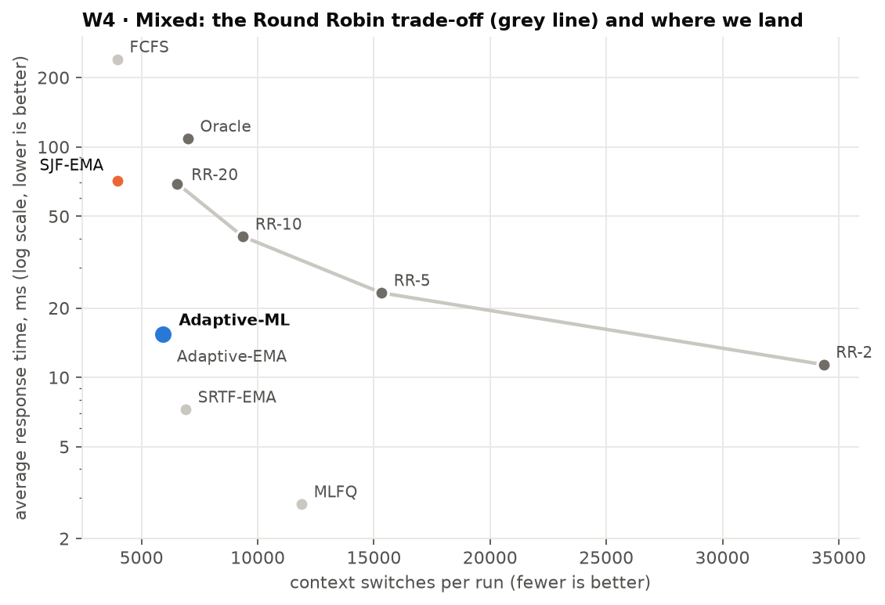
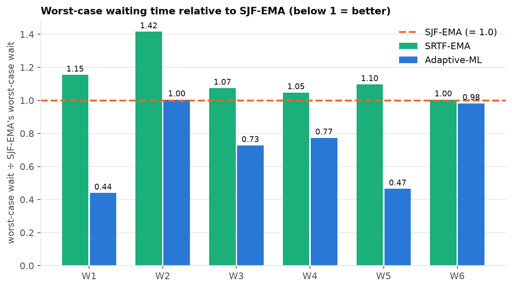
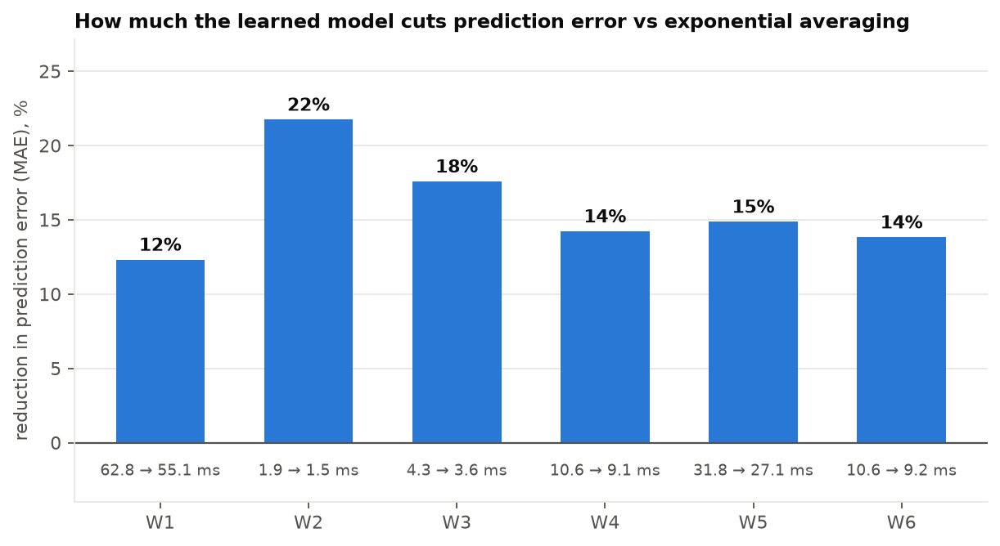
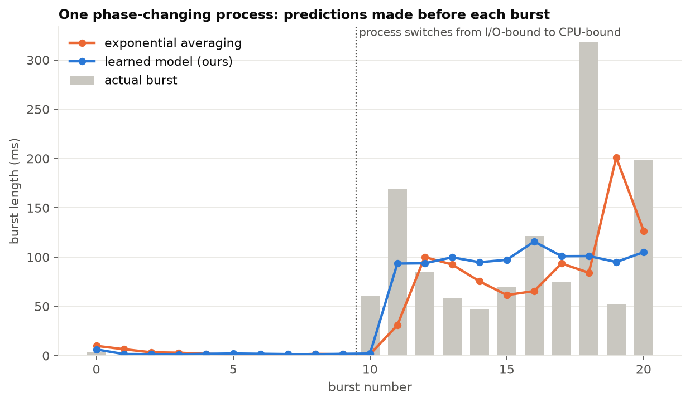
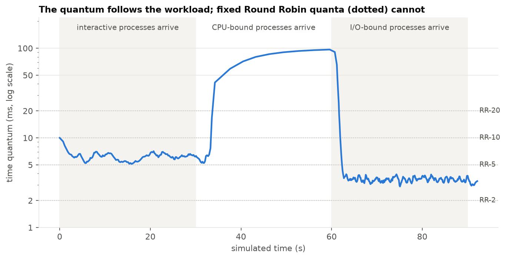
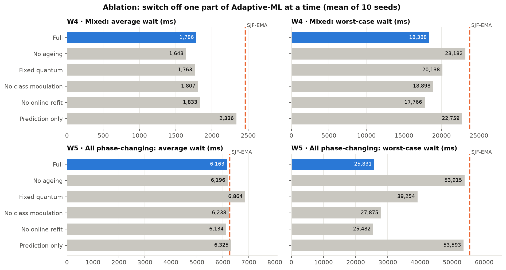
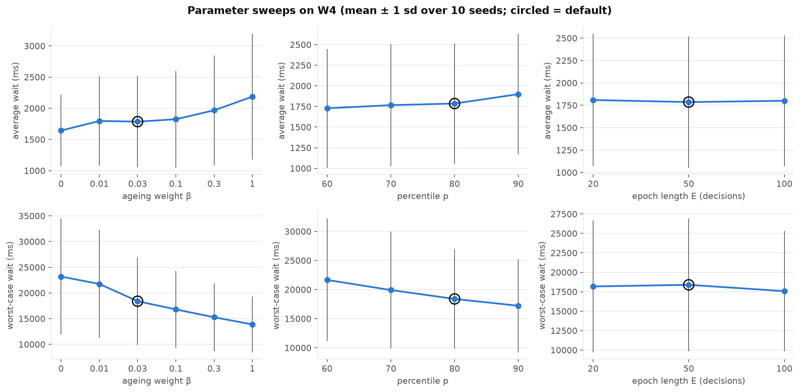

# Results report

Generated by `analyse.py` from 660 main runs (6 workloads × 11 schedulers × 10 seeds, 200 processes per run), 120 ablation runs, 130 sweep runs and 150 switch-cost runs. Every scheduler sees the same workload instances, so comparisons are paired by seed. All times are in milliseconds. Context-switch cost is 0.1 ms unless stated.

## Headline (W4, mixed workload)

- Average waiting time: **1,786 ms** for Adaptive-ML vs 2,460 ms for SJF with exponential averaging (**-27.4%**), and 1,204 ms for the oracle.
- That closes **54%** of the gap between SJF-EMA and the oracle.
- Worst-case wait: 18,388 ms vs 23,766 ms for SJF-EMA (-22.6%).
- Context switches: 5,933 vs 15,328 for RR-5 (-61.3%), with average response time 15.4 ms (RR-5: 23.3, RR-20: 69.3).

## 1. Average waiting time (mean ± sd over seeds)

| Scheduler | W1 | W2 | W3 | W4 | W5 | W6 |
|---|---|---|---|---|---|---|
| FCFS | 2,356 ± 1,467 | 454 ± 194 | 490 ± 155 | 4,003 ± 1,780 | 4,330 ± 1,433 | 38,210 ± 1,937 |
| SJF-EMA | 2,778 ± 1,727 | 395 ± 143 | 480 ± 147 | 2,460 ± 791 | 6,269 ± 2,451 | 17,150 ± 1,801 |
| SRTF-EMA | 2,881 ± 1,728 | 432 ± 154 | 489 ± 159 | 1,729 ± 720 | 6,830 ± 2,320 | 16,490 ± 1,747 |
| RR-2 | 3,478 ± 2,021 | 556 ± 245 | 608 ± 213 | 2,394 ± 1,069 | 7,675 ± 2,463 | 22,998 ± 2,097 |
| RR-5 | 2,931 ± 1,753 | 470 ± 203 | 523 ± 180 | 2,180 ± 989 | 6,576 ± 2,266 | 23,615 ± 2,096 |
| RR-10 | 2,755 ± 1,668 | 460 ± 198 | 498 ± 166 | 2,276 ± 1,047 | 6,127 ± 2,131 | 26,088 ± 2,204 |
| RR-20 | 2,661 ± 1,624 | 454 ± 194 | 488 ± 156 | 2,572 ± 1,210 | 5,713 ± 1,986 | 30,333 ± 2,389 |
| MLFQ | 2,814 ± 1,733 | 503 ± 215 | 542 ± 187 | 1,878 ± 869 | 6,566 ± 2,340 | 22,762 ± 2,167 |
| Oracle | 1,697 ± 930 | 370 ± 200 | 283 ± 113 | 1,204 ± 484 | 4,617 ± 1,590 | 12,820 ± 1,542 |
| Adaptive-EMA | 2,915 ± 1,791 | 423 ± 169 | 487 ± 159 | 1,851 ± 752 | 6,569 ± 2,436 | 18,017 ± 1,914 |
| Adaptive-ML | 2,725 ± 1,692 | 450 ± 180 | 505 ± 182 | 1,786 ± 730 | 6,163 ± 2,235 | 17,599 ± 2,335 |

Workloads: **W1** All CPU-bound; **W2** All I/O-bound; **W3** All interactive; **W4** Mixed (40% interactive, 30% CPU, 20% I/O, 10% phase); **W5** All phase-changing; **W6** Mixed at 3x arrival rate (overload).

## 2. Adaptive-ML against the main baseline (SJF-EMA), per workload

| Workload | Avg wait change | Seeds where better | Oracle gap closed | Worst wait change | Switches change | Mean quantum (ms) |
|---|---|---|---|---|---|---|
| W1 | -1.9% | 7/10 | 5% | -56.0% | +32.6% | 92.0 |
| W2 | +13.8% | 0/10 | -216% | +0.5% | +16.7% | 3.5 |
| W3 | +5.3% | 2/10 | -13% | -27.2% | +25.7% | 6.4 |
| W4 | -27.4% | 10/10 | 54% | -22.6% | +49.2% | 18.1 |
| W5 | -1.7% | 4/10 | 6% | -53.4% | +24.9% | 95.0 |
| W6 | +2.6% | 2/10 | -10% | -1.8% | +67.6% | 14.4 |

Negative change = Adaptive-ML is lower (better). Oracle gap closed = (SJF − ours) / (SJF − oracle). A negative value means Adaptive-ML was worse than SJF-EMA.

## 3. All metrics on W4 (mean over seeds)

| Scheduler | Avg wait | Worst wait | Turnaround | Response | Switches | CPU util | Throughput /s | Jain fairness | Starved | Pred. MAE |
|---|---|---|---|---|---|---|---|---|---|---|
| FCFS | 4,003 | 19,407 | 5,628 | 240 | 3,962 | 0.809 | 2.17 | 0.732 | 17.70 | – |
| SJF-EMA | 2,460 | 23,766 | 4,085 | 71.3 | 3,977 | 0.813 | 2.18 | 0.829 | 9.10 | 10.62 |
| SRTF-EMA | 1,729 | 24,903 | 3,354 | 7.3 | 6,902 | 0.819 | 2.20 | 0.842 | 10.20 | 10.62 |
| RR-2 | 2,394 | 16,996 | 4,019 | 11.4 | 34,354 | 0.815 | 2.19 | 0.774 | 6.40 | – |
| RR-5 | 2,180 | 14,887 | 3,805 | 23.3 | 15,328 | 0.817 | 2.19 | 0.782 | 3.40 | – |
| RR-10 | 2,276 | 14,117 | 3,901 | 40.8 | 9,365 | 0.816 | 2.19 | 0.775 | 2.80 | – |
| RR-20 | 2,572 | 13,386 | 4,198 | 69.3 | 6,542 | 0.815 | 2.19 | 0.761 | 2.70 | – |
| MLFQ | 1,878 | 15,016 | 3,503 | 2.8 | 11,888 | 0.818 | 2.20 | 0.796 | 3.90 | – |
| Oracle | 1,204 | 22,905 | 2,830 | 109 | 6,994 | 0.819 | 2.20 | 0.869 | 5.80 | – |
| Adaptive-EMA | 1,851 | 24,088 | 3,477 | 14.7 | 5,848 | 0.818 | 2.20 | 0.832 | 8.80 | 10.62 |
| Adaptive-ML | 1,786 | 18,388 | 3,411 | 15.4 | 5,933 | 0.818 | 2.20 | 0.816 | 6.70 | 9.11 |

Starved = processes whose waiting time exceeded 5× the cross-scheduler mean wait for that workload instance. Jain fairness is computed on each process's progress rate ((CPU + I/O time) / turnaround). (Service received ÷ demanded, as first planned, is always 1 here because every process eventually finishes.)

## 4. Hypotheses (stated in Review 1, before any experiment)

| # | Hypothesis | Verdict | Evidence |
|---|---|---|---|
| H1 | Lower average wait than SJF-EMA on W4, W5, W6 (largest on W5). Rule: mean paired improvement > 1 sd across seeds. | **Partly supported** | W4: -27.4%, mean improvement 674 vs sd 117 → passes; W5: -1.7%, mean improvement 106 vs sd 615 → fails; W6: +2.6%, mean improvement -449 vs sd 630 → fails. Largest improvement on W4, not on W5 as predicted. |
| H2 | Far fewer context switches than small-quantum RR, without response time collapsing. Rule: < half of RR-5's switches and lower response time than RR-20. | **Supported** | Holds on W4: yes. Holds on: W1, W4, W5, W6. |
| H3 | Lower worst-case wait than SJF-EMA and SRTF-EMA (thanks to ageing). | **Partly supported** | W1 ✓, W2 ✗, W3 ✓, W4 ✓, W5 ✓, W6 ✓. |
| H4 | About equal to SJF-EMA on uniform workloads W1, W2 (within ±10%). | **Partly supported** | W1: -1.9%, W2: +13.8%. |
| H5 | Never beats the oracle on average wait. | **Supported** | Adaptive-ML beat the oracle in 0 of 60 workload instances. Note: on average, FCFS beat it on W5. The oracle is SRTF on true *burst* lengths: optimal for single-burst jobs, but not a bound when processes have many bursts (see notes). |
| H6 | Lower prediction MAE than exponential averaging on W5. | **Supported** | MAE in ms, EMA→ML: W1 62.8→55.1, W2 1.9→1.5, W3 4.3→3.6, W4 10.6→9.1, W5 31.8→27.1, W6 10.6→9.2 (lower on 6/6 workloads). |
| H7 | Removing ageing slightly lowers the average but raises worst-case wait and starvation. | **Partly supported** | W4: avg 1,786→1,643, worst 18,388→23,182, starved 6.7→8.2; W5: avg 6,163→6,196, worst 25,831→53,915, starved 0.2→8.0 (Full→No ageing). |

## 5. Prediction accuracy

Offline training: 2000 processes (45,389 bursts) from seeds never used in the experiments, split **by process** (1500 train / 500 test).

| Model | MAE | RMSE | MAE cpu | MAE io | MAE interactive | MAE phase | Latency (ms) |
|---|---|---|---|---|---|---|---|
| Exponential averaging | 12.36 | 32.23 | 60.1 | 1.91 | 4.38 | 31.5 | 0.000 |
| Ridge | 14.82 | 31.20 | 54.9 | 5.89 | 5.86 | 34.2 | 0.080 |
| Ridge (log target) | 22.54 | 169.95 | 96.4 | 1.58 | 3.58 | 70.9 | 0.082 |
| Gradient boosting | 12.59 | 29.12 | 53.1 | 3.59 | 4.76 | 30.5 | 0.503 |
| Gradient boosting (log target) | 10.62 | 29.24 | 54.1 | 1.53 | 3.59 | 26.8 | 0.502 |

Chosen: **Gradient boosting (log target)** (rule: lowest MAE within a 1 ms latency budget; Ridge preferred if within 5%). Beats exponential averaging on held-out data: **yes**. Classifier: Logistic regression macro-F1 0.939, Random forest macro-F1 0.942; chosen **Logistic regression**.

## 6. Ablation (Adaptive-ML with one part switched off)

| Workload | Variant | Avg wait | Worst wait | Response | Switches | Starved |
|---|---|---|---|---|---|---|
| W4 | Full | 1,786 | 18,388 | 15.4 | 5,933 | 6.7 |
| W4 | No ageing | 1,643 | 23,182 | 15.1 | 5,756 | 8.2 |
| W4 | Fixed quantum | 1,763 | 20,138 | 8.4 | 6,609 | 8.0 |
| W4 | No class modulation | 1,807 | 18,898 | 14.3 | 5,993 | 6.5 |
| W4 | No online refit | 1,833 | 17,766 | 15.0 | 5,975 | 6.9 |
| W4 | Prediction only | 2,336 | 22,759 | 72.3 | 3,980 | 8.0 |
| W4 | *SJF-EMA (reference)* | 2,460 | 23,766 | 71.3 | 3,977 | 9.1 |
| W5 | Full | 6,163 | 25,831 | 48.1 | 4,098 | 0.2 |
| W5 | No ageing | 6,196 | 53,915 | 50.4 | 3,885 | 8.0 |
| W5 | Fixed quantum | 6,864 | 39,254 | 9.7 | 8,062 | 3.4 |
| W5 | No class modulation | 6,238 | 27,875 | 43.3 | 4,147 | 0.4 |
| W5 | No online refit | 6,134 | 25,482 | 49.6 | 4,104 | 0.0 |
| W5 | Prediction only | 6,325 | 53,593 | 69.3 | 3,278 | 8.2 |
| W5 | *SJF-EMA (reference)* | 6,269 | 55,480 | 69.5 | 3,280 | 7.7 |

*Prediction only* = ML-predicted SJF (no ageing, no quantum). Comparing it with SJF-EMA isolates the value of the better prediction alone.

## 7. Parameter sweeps on W4

| Parameter | Value | Avg wait | Worst wait | Switches |
|---|---|---|---|---|
| beta | 0 | 1,643 | 23,182 | 5,756 |
| beta | 0.01 | 1,796 | 21,746 | 5,855 |
| beta | 0.03 (default) | 1,786 | 18,388 | 5,933 |
| beta | 0.1 | 1,823 | 16,792 | 6,128 |
| beta | 0.3 | 1,967 | 15,267 | 6,435 |
| beta | 1 | 2,185 | 13,879 | 7,037 |
| p | 60 | 1,728 | 21,649 | 7,180 |
| p | 70 | 1,766 | 19,915 | 6,600 |
| p | 80 (default) | 1,786 | 18,388 | 5,933 |
| p | 90 | 1,899 | 17,213 | 5,077 |
| epoch | 20 | 1,809 | 18,179 | 5,975 |
| epoch | 50 (default) | 1,786 | 18,388 | 5,933 |
| epoch | 100 | 1,801 | 17,574 | 5,925 |

### Context-switch cost sensitivity (W4)

| Scheduler | avg wait @ 0.05 ms switch | avg wait @ 0.1 ms switch | avg wait @ 0.5 ms switch |
|---|---|---|---|
| Adaptive-ML | 1,768 | 1,786 | 2,136 |
| MLFQ | 1,782 | 1,878 | 2,880 |
| RR-20 | 2,510 | 2,572 | 3,089 |
| RR-5 | 2,057 | 2,180 | 3,528 |
| SJF-EMA | 2,433 | 2,460 | 2,640 |

## 8. How β was chosen

β had no default in the plan. It was chosen by `tune_beta.py` on seeds [100, 101, 102], which the experiments above never use. Score per workload = (avg wait ÷ SJF avg wait + worst wait ÷ SJF worst wait) / 2; lowest mean score wins.

| β | W1 | W2 | W3 | W4 | W5 | W6 | mean |
|---|---|---|---|---|---|---|---|
| 0 | 1.118 | 1.171 | 0.927 | 0.989 | 0.950 | 0.978 | 1.022 |
| 0.003 | 0.974 | 1.084 | 0.903 | 0.966 | 0.791 | 1.005 | 0.954 |
| 0.01 | 0.820 | 1.092 | 0.864 | 0.918 | 0.727 | 1.009 | 0.905 |
| 0.03 | 0.761 | 1.070 | 0.848 | 0.837 | 0.703 | 1.024 | 0.874 |
| 0.1 | 0.748 | 1.128 | 0.850 | 0.793 | 0.677 | 1.125 | 0.887 |
| 0.3 | 0.720 | 1.130 | 0.844 | 0.765 | 0.609 | 1.196 | 0.877 |

Chosen β = **0.03**.

## Scheduler configurations

| Name | Description |
|---|---|
| FCFS | First-Come-First-Served |
| SJF-EMA | Shortest-Job-First, bursts guessed by exponential averaging (alpha 0.5) |
| SRTF-EMA | Shortest-Remaining-Time-First, same guess, preemptive |
| RR-2 | Round Robin, 2 ms quantum |
| RR-5 | Round Robin, 5 ms quantum |
| RR-10 | Round Robin, 10 ms quantum |
| RR-20 | Round Robin, 20 ms quantum |
| MLFQ | Multilevel feedback queue, 3 levels (4/8/16 ms), boost every 200 ms |
| Oracle | Best possible case: SRTF that knows the true burst lengths |
| Adaptive-EMA | Our scheduler, but with exponential averaging as the predictor |
| Adaptive-ML | Our scheduler: learned predictor + ageing + adaptive quantum |
